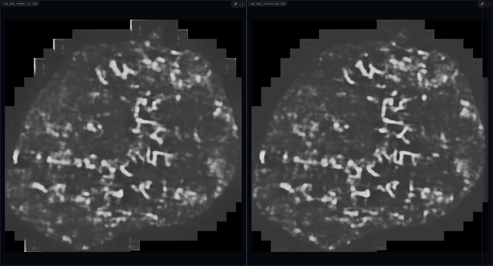

# Ink Viewer

[](https://github.com/LimeGS/ink-viewer/actions/workflows/audit.yml)
[](https://github.com/LimeGS/ink-viewer/actions/workflows/tests.yml)
[](LICENSE)

**Explore, compare and annotate 2D ink-detection maps from Vesuvius scroll datasets in your browser.**

Run on macOS, Linux or your own server with local, HTTP or S3 data. No GPU or cloud provider is required. Bring your own prepared dataset; maps, annotations, credentials and machine settings stay outside this repository.

## Features

- Search and filter scrolls, segments, model runs and depth offsets in one explorer.
- Compare models side by side and inspect contrast, gamma, thresholds and colour-map treatments.
- Review existing v5 scores, quality gates and calibrated measurements when supplied by the dataset.
- Paint ink and reviewed non-ink, undo edits, import masks and export matched annotation pairs with grid provenance.
- Browse with lazy thumbnails and previews; annotate on the full-resolution original raster.
- Run a public ink model on the open segment through [ink-sdk](https://github.com/LimeGS/ink-sdk) (optional) and add its maps to the list.
- Click a map point to see the CT cross-section through it, with the segment's mesh drawn on top (optional).

The frontend uses JavaScript, HTML and CSS; Python serves data and validates saves. There is no frontend build step. The viewer does not train models or render 3D meshes; inference runs only through the optional ink-sdk integration, and CT is read only for cross-sections. Missing scores and calibration remain unknown.




## Quick start

Requires **Python 3.10+**, Git, macOS or Linux, and a current browser with Canvas and IndexedDB support. Node.js is needed only for development tests.

```sh
git clone https://github.com/LimeGS/ink-viewer.git
cd ink-viewer
python3 -m venv .venv
source .venv/bin/activate
python -m pip install .
ink-viewer --origen /absolute/path/to/dataset
```

Open **[http://127.0.0.1:8797/all-gallery/index.html](http://127.0.0.1:8797/all-gallery/index.html)**. Keep the process running; stop it with `Ctrl+C`. `python -m ink_viewer` is an equivalent entry point.

The dataset must have a compatible viewer manifest. For a local catalog containing `PHerc.../segments/<segment>/ink-detection/` with catalog-named PNG or single-page integer TIFF maps, inspect discovery and generate its index first:

```sh
ink-viewer-manifest --origen /absolute/path/to/catalog --dry-run
ink-viewer-manifest --origen /absolute/path/to/catalog
ink-viewer --origen /absolute/path/to/catalog
```

This creates `_viewer/manifest.json` and `_viewer/index-info.json`, without rewriting maps. See [dataset layout and naming](docs/guide.md#prepare-a-dataset) for requirements and existing manifest formats.

### Save annotations

Create a separate local directory and supply it at startup:

```sh
mkdir -p "$HOME/ink-viewer-annotations"
ink-viewer --origen /absolute/path/to/dataset \
  --anotaciones "$HOME/ink-viewer-annotations"
```

Omitting `--anotaciones` disables server saves; browser-local editing and downloads remain available. Browser storage is not a backup. Saves go to the configured folder on the server, even when maps come from S3; the source bucket is not modified.

Masks retain the original image grid. Binary-pair, ink-only and tri-state imports have different meanings for unknown pixels; read [annotation formats and integrity](docs/guide.md#annotation-formats-and-integrity) before exchanging labels.

## Data sources

### Public S3 or HTTP, without credentials

Use the dataset's HTTPS object endpoint, replacing the placeholders:

```sh
ink-viewer --origen \
  "https://YOUR_BUCKET.s3.YOUR_REGION.amazonaws.com/YOUR_DATASET_PREFIX"
```

Point to the indexed dataset root, not a PNG or AWS Console page. The index and referenced maps must be publicly readable. HTTP cannot discover a catalog by directory listing: public objects alone are insufficient without a viewer manifest. The same command accepts another HTTP server or CDN root.

### Authenticated S3 and compatible storage

```sh
ink-viewer --origen s3://YOUR_BUCKET/YOUR_DATASET_PREFIX \
  --s3-perfil research --s3-region YOUR_REGION
```

Omit `--s3-perfil` to use the standard SDK credential chain. Add `--s3-endpoint https://storage.example.org` for a compatible store. The current `s3://` mode uses SDK authentication; use HTTPS for anonymous public browsing.

See the guide for [public index preparation and publication](docs/guide.md#connect-to-public-s3), [authenticated storage](docs/guide.md#authenticated-s3-and-compatible-storage), and [configuration flags, environment variables and JSON](docs/guide.md#configuration).

## Self-hosting

Install and run the same application on your server. It listens on **127.0.0.1:8797**. To access it from your laptop:

```sh
ssh -N -o ExitOnForwardFailure=yes \
  -L 127.0.0.1:8797:127.0.0.1:8797 user@your-server
```

Open the same localhost URL on the laptop and keep both the server and tunnel running. Use matching local and remote ports because the application checks the Host header. If `8797` is occupied, choose another port on both sides and start the viewer with that `--port`.

The guide covers [persistent Linux services](docs/guide.md#deploy-on-your-own-server) and optional [managed releases, previews and rollback](docs/guide.md#managed-releases-previews-and-rollback). A static S3 website alone cannot host the application; its Python API is required.

## Security

Ink Viewer assumes a **trusted operator**. It has no user accounts or per-user authorization. The source picker acts with the server account's filesystem and network permissions, so application access grants more than access to the selected dataset.

Keep access private through loopback/SSH, run with least privilege, keep credentials outside Git and browser code, and back up annotations. Shared deployments need access control and integration with Host/Origin checks; HTTPS alone is not authentication. See the [security guidance](docs/guide.md#security) for details.

Report vulnerabilities privately using **Report a vulnerability** on the [Security tab](https://github.com/LimeGS/ink-viewer/security), if available. Otherwise, open a minimal issue requesting a private contact without publishing exploit details or sensitive data. Include the affected commit, impact and a synthetic reproduction in the private report.

Dependency audits run on pushes and pull requests. A passing badge means the tools found no known dependency advisories at that time; it is not a complete security assessment.

## Contributing

Bug fixes, documentation and synthetic test fixtures are welcome. Use [issues](https://github.com/LimeGS/ink-viewer/issues) for ordinary bugs or proposals; include reproduction steps, expected/actual behaviour and relevant software versions. Discuss substantial changes first, then submit a focused pull request from a branch on your fork against `main`.

For development, use Node 24 (CI's version), activate the Python virtual environment above, and install test dependencies:

```sh
python -m pip install -e '.[test]'
npm ci
python -m unittest discover -s tests/python -p 'test_*.py'
npm test
```

CI enforces **≥90% line coverage separately for Python and browser JavaScript**, plus dependency audits. Use the [full coverage and audit commands](docs/guide.md#run-checks) before submitting. Add meaningful tests for changed behaviour and screenshots for UI changes; also verify UI changes in a real browser, since DOM unit tests do not establish visual correctness.

Keep code under `src/` and research data, generated reports, local settings and secrets outside Git. Preserve native image coordinates, mask ownership and calibration. Explain the problem, resulting behaviour and validation in your pull request. See [architecture and source layout](docs/architecture.md) and the [development reference](docs/guide.md#development-reference).

## Documentation

- [User and deployment guide](docs/guide.md): dataset formats, S3 publishing, configuration, systemd, releases, annotations, troubleshooting and development checks.
- [Architecture](docs/architecture.md): component boundaries, browser loading and source releases.
- CLI reference: `ink-viewer --help`, `ink-viewer-manifest --help`, `ink-viewer-deploy --help`.

## Licenses

Application code uses the [MIT License](LICENSE). The bundled Inter font retains its [SIL Open Font License](LICENSE-Inter.txt). Third-party datasets and research assets keep their owners' licenses; MIT does not grant rights to those assets.
